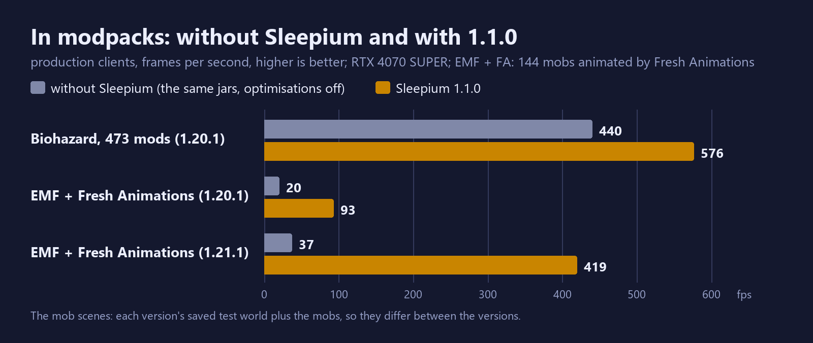
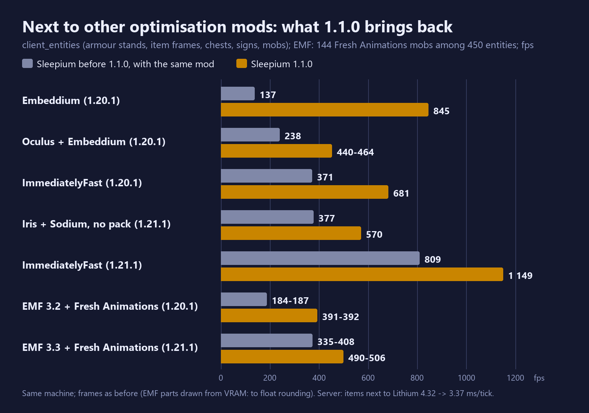
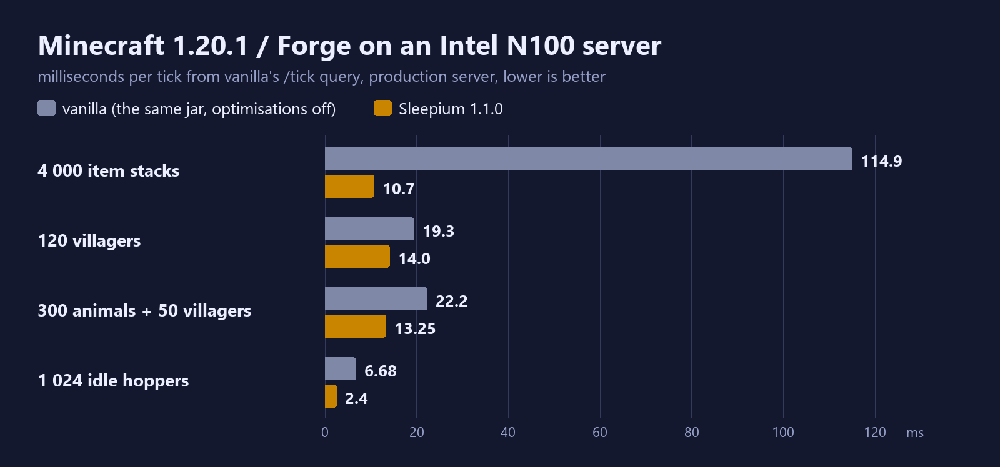

# Sleepium

A performance engine for modded Minecraft that changes nothing the game computes. Every optimisation is checked
against vanilla: the same world after thousands of ticks (block and entity hashes), the same frame bit for bit.

Next to other optimisation mods it works with them, not against them: where another mod already changes the same code,
Sleepium steps aside there and says so in the log.

> **Using C2ME? Use Sleepium 1.1.4 or newer, and check your world.** Before 1.1.4, Sleepium together with C2ME (or
> another mod that saves chunks on its own threads) could save chunks with parts missing. That was my bug, found and
> fixed in 1.1.4. Signs of it: `No key palette in MapLike[{}]` in the log, chunks that look hollow or do not appear.
> 1.1.4 saves correctly (tested: a world generated with C2ME, the game restarted, every chunk read back without an
> error), but it cannot restore data that was never written. If you played with C2ME on an older version, regenerate
> the broken chunks - delete them with MCA Selector, or the region files of that area in `saves/<world>/region` - or
> start a new world. Anything built in those chunks is lost when they regenerate.

## Versions

<!-- board: generated by tools/board.py from the branches and versions.json - do not edit by hand -->
| Minecraft | Loader | State | Branch | Latest release | Java |
|---|---|---|---|---|---|
| 1.21.1 | NeoForge | supported (main line) | [`1.21.1-neoforge`](../../tree/1.21.1-neoforge) | 1.1.4 | 21 or newer |
| 1.20.1 | Forge | supported (long-term) | [`1.20.1-forge`](../../tree/1.20.1-forge) | 1.1.4 | 17 or newer |
<!-- /board -->

Download from [Modrinth](https://modrinth.com/mod/sleepium), [CurseForge](https://www.curseforge.com/projects/1780057)
or the [GitHub releases](../../releases). Each release has one jar per supported version:
`sleepium-<version>+mc<minecraft>-<loader>.jar`.

## Results at a glance

| | without Sleepium | with Sleepium |
|---|---:|---:|
| 4 000 items on the ground, Intel N100 server, ms per tick (1.21.1) | 111 | 8.1 |
| 4 000 items on the ground, Intel N100 server, ms per tick (1.20.1) | 115 | 10.7 |
| A Cursed Fate fight (840 entities, burning mobs), fps, 1.20.1 | 87 | 600-646 |
| The Biohazard pack (473 mods, 1.20.1), a new world, fps | 351-379 | 571-578 |
| 144 Fresh Animations mobs (Entity Model Features 3.3) among 450 other entities, fps, 1.21.1 | 42-46 | 490-506 |
| World generation with JJThunder To The Max (Chunky, 16 threads), chunks per second, 1.21.1 | 30 | 93-100 |

How these were measured, on which hardware, and many more scenes: [docs/results.md](docs/results.md).

## Install

Put the jar for your Minecraft version and loader into `mods/`. Nothing else is required; it runs on clients and
servers. Settings: *Options → Sleepium...*

## How this repository is organized

- **Each supported version has its own branch**, named after the Minecraft version and the loader
  (`1.21.1-neoforge`, `1.20.1-forge`). A branch is a complete mod for that version: its own build, its own tests, a
  README about what is special there. There is no shared core and no preprocessor: what a branch holds is exactly
  what runs.
- **This branch (`main`) is the front page**: this README, the documentation for all versions, the changelog.
- **Versions no longer supported** move to `eol/<minecraft>-<loader>` branches, with a tag of their last release; they
  stay readable and buildable. The table above lists them too.
- A change made for one version is brought to the others by the maintainers, or marked as specific to that version.

Want to contribute? See [CONTRIBUTING.md](CONTRIBUTING.md) - in short: a pull request to the branch of your version.

## Documentation

- [How it works](docs/how-it-works.md) - block-entity and entity sleep, the event bus, collisions, rendering, ...
- [Results](docs/results.md) - measurements, hardware, comparisons with other mods
- [Testing](docs/testing.md) - how exactness is checked: world hashes, frame hashes, production runs
- [Compatibility](docs/compatibility.md) - other mods tested, per version, and where Sleepium steps aside
- [Settings](docs/settings.md) - the settings screen, flags, opt-in features, shaderpacks
- [Versions](docs/versions.md) - what each version has, and how versions are supported
- [Changelog](CHANGELOG.md)

## License

LGPL-3.0-only ([LICENSE](LICENSE), [COPYING](COPYING)).
