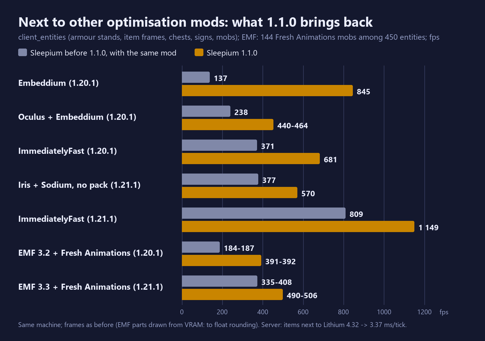

# Compatibility

Sleepium is tested together with other optimisation mods, one at a time and as packs. Where another mod changes the same code, Sleepium steps aside there and says so in the log (`[sleep/opt] ... not applied: ...`).

## Minecraft 1.21.1 / NeoForge

Tested on 2026-11-03 (notes/53): each mod on the production NeoForge client together with Sleepium 1.0.3, the world
loaded and drawn for a measured window, no exceptions; and 13 of them at once. Five crashed or broke with 1.0.2 and
were fixed in 1.0.3 (Embeddium, ModernFix, Lithium, Moonrise, C2ME).

Sodium 0.8.13, Iris 1.8.14 (with a shaderpack too), Embeddium 1.0.15, Lithium 0.15.4, Moonrise 0.1.0-beta.15,
C2ME 0.4.0-alpha, ModernFix 5.27.27, FerriteCore 7.0.3, ImmediatelyFast 1.6.15, EntityCulling 1.11.3,
ScalableLux 0.1.0.1, Radium 0.13.1, BadOptimizations 2.4.1, Dynamic FPS 3.11.4, Chloride 1.8.1, Noisium 2.3.0,
spark 1.10.124, FastSuite 6.0.7, Ksyxis 1.4.6, ServerCore 1.5.19, Clumps 19.0.0.1, Create 6.0.10.

With Lithium or with Moonrise installed, the exactness check still holds (hoppers, items, mobs: Sleepium off = on).
Server speed together (host, mean ms per tick, one pass each):

| scene | Sleepium | + Lithium | + Moonrise |
|---|---:|---:|---:|
| items | 3.30 | 4.13 | **2.35** |
| hoppers | 0.27 | 0.20 | **0.10** |
| carts | 2.78 | 2.80 | **1.87** |
| crops | 0.30 | 0.30 | **0.00** |
| fluids | 1.70 | **1.02** | 1.43 |
| pistons | 1.28 | 1.02 | **0.60** |
| redstone | 3.72 | 2.45 | **2.15** |
| mobs | 3.23 | 3.07 | **2.80** |

Moonrise on top of Sleepium is faster in most scenes (its random ticks are not vanilla-exact, so crops are not a fair
comparison); Lithium helps fluids, redstone and pistons and slows items.

### Since 1.1.0

- **Entity sleep next to mods that mix into `Entity`** (Lithium, Radium, Canary and most packs): the analyses used to
  refuse every method another mod's mixin changes, so with Lithium no item ever slept. They now read those methods as
  they run (the class put through Mixin's transformer again; only what other mods change, plus the handlers and
  interfaces they add). Items with Lithium: 4.32 -> 3.37 ms per tick (Sleepium alone 3.30), exact.
- **ModernFix** no longer turns off the collision shape cache (its lazy block-state cache redirects every read of the
  cache; only methods that read it count as changed now).
- **Iris / Sodium without a shaderpack** and **ImmediatelyFast**: their batching buffer sources no longer keep the
  render cache from drawing from video memory - client_entities with Iris + Sodium 377 -> 570 fps, with ImmediatelyFast
  809 -> 1 149 fps, frames bit for bit the same as before.
- **Mods in `EntityRenderDispatcher.render`** (Iris / Oculus, ETF, Entity Model Features, Embeddium) keep entities on
  the render thread, as before: those mods keep the entity being drawn in globals that their mixins in renderers and
  models read and write, so a worker would draw with another entity's state (with Fresh Animations, Entity Model
  Features crashed that way in a test build). Merging inside the dispatcher is there to try (`-Dlab.prender.inner=true`)
  but not on. With Entity Model Features + Fresh Animations, 144 animated mobs: 37 -> 419 fps (1.21.1).
- **TerraBlender** (and the many mods built on it) no longer crashes the game at start: it makes methods Sleepium
  replaces public, and Mixin refused Sleepium's narrower ones (1.0.x on 1.21.1 too).

## Minecraft 1.20.1 / Forge

Tested on 2026-11-05 with the mods of the Biohazard: Project Genesis pack, each one alone with Sleepium and all together.

### Server, ms per tick (desktop, dev server, 20 s warm-up, 30 s of `/tick query`)

| | items | hoppers | mobs | villagers | redstone | fluids |
|---|---:|---:|---:|---:|---:|---:|
| vanilla | 47.45 | 1.42 | 6.48 | 6.27 | 4.78 | 3.57 |
| Sleepium | 4.02 | 0.55 | 3.65 | 4.08 | 4.10 | 2.77 |
| Radium 0.12.4 | 5.58 | 1.02 | 3.58 | 3.27 | 2.83 | 2.93 |
| Canary 0.3.3 | 6.80 | 1.05 | 3.70 | 3.33 | 3.00 | 3.02 |
| Radium + Sleepium | **3.92** | **0.60** | **3.38** | | | |
| ModernFix + Sleepium | 4.35 | | 3.17 | | | |
| Radium + ModernFix + FerriteCore (the pack's set) | 4.90 | 0.80 | **2.83** | 3.37 | | |
| the set + Sleepium | | | 3.08 | **2.82** | | |

On the Intel N100 (production server): items with the set 15.7 -> 9.1 ms with Sleepium. Known: next to Radium, mobs
are about 0.25 ms (desktop) to 0.4 ms (N100) slower with Sleepium than with the set alone - no single cause found yet.

Exactness with the set (production server, the built jar): items, hoppers, mobs EXACT; without other mods hoppers,
items, mobs, redstone, villagers EXACT.

### Client, fps (client_entities unless noted; RTX 4070 SUPER, 1280x720)

| mod(s) | without Sleepium | with Sleepium | check |
|---|---:|---:|---|
| Embeddium 0.3.31 | 110 | 845 | render cache verify: 478 934 hits, 0 mismatches |
| Oculus 1.8.0 + Embeddium (no pack) | 197 | 440-464 | frame as Sleepium's old path |
| ImmediatelyFast 1.5.5 | | 681 | frame = without other mods |
| EntityCulling, ModernFix, FerriteCore, Radium, Canary, Create | | 1 615-1 929 | run, no failures |
| sodiumdynamiclights + Embeddium | | 863 | runs |
| the whole set (13 mods), a horde of burning zombies | | 544 | entities on the render thread (Oculus, Embeddium in the dispatcher) |
| a Cursed Fate fight with Oculus + Embeddium | 289 | 299 | |
| the Biohazard pack (473 mods), a new world | 440 | 576 | starts, plays; Sleepium steps aside in 38 places |
| Entity Model Features + ETF + Fresh Animations, 144 mobs | 20 | 93 | |

Where Sleepium steps aside on 1.20.1: with Embeddium / Oculus the chunk renderer and a few render hooks (their own),
with Radium / Canary collisions, entity sections, POI search and brains (theirs), with ModernFix parts of world
generation. Not ours, seen without Sleepium too: Embeddium's taint warning when Oculus mixes into it; dynamic lights'
optional mixins for absent Sodium / Fabric classes.
