# Results

Measurements of Sleepium against the same game without it. Unless a table says otherwise the numbers are for Minecraft 1.21.1 / NeoForge; the 1.20.1 / Forge results are at the end ([On 1.20.1 / Forge](#on-1201--forge)).

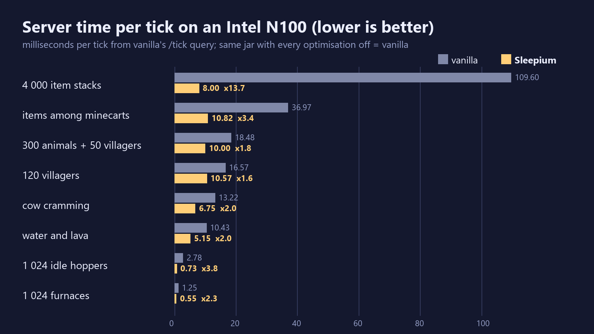

| Complementary Reimagined, run by Sleepium's own renderer (beta) | The settings screen (Options → Sleepium...) |
|---|---|
| 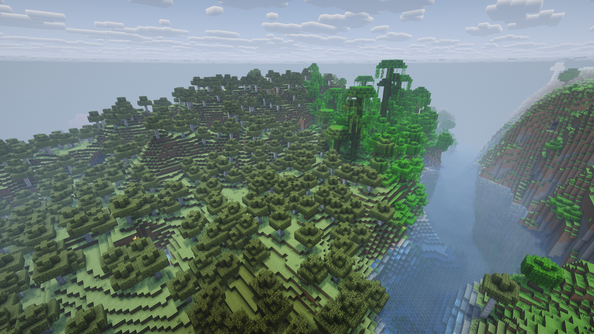 | 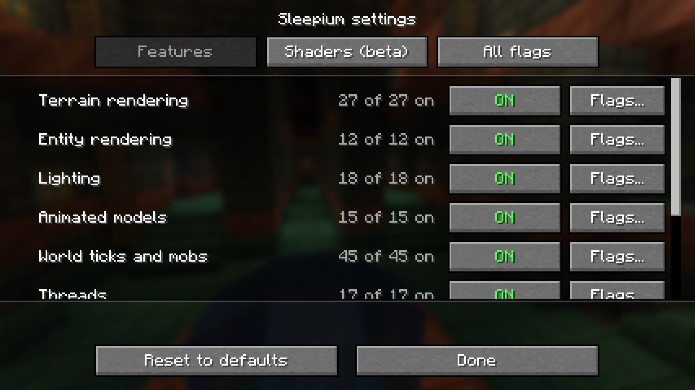 |

### With Create

Client on real Create worlds (RTX 4070 SUPER, 1280×720, Flywheel on, Sleepium's defaults; "vanilla" = the same mods
without Sleepium): **Alpha Industries** (12 880 Create block entities) 48 → 176–207 fps; **Create Aeronautics**' ship
SS.Venator placed 108 → 283–297 fps, assembled into a Sable sub-level 101 → 254 fps. Frames are vanilla's but for
smoke and clouds (time-driven). Experimental and off by default (`-Dlab.opt.SbbPartsMixin`): Create's kinetic parts
drawn by Sleepium instead of Flywheel, 2 181–2 189 fps against Flywheel's 1 523–1 570 on a scene of driven lines and
belts.

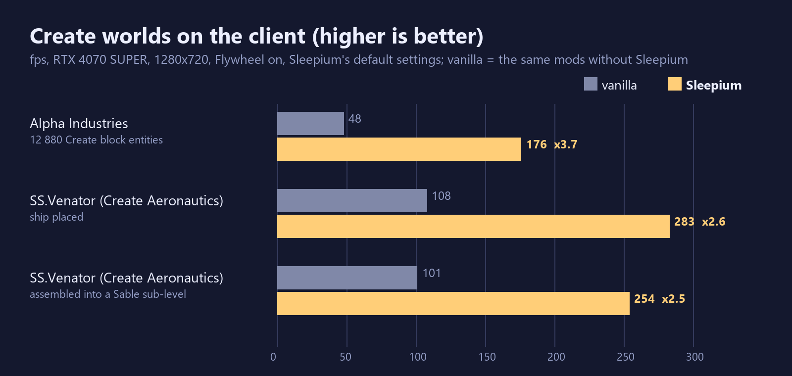

### Water and glass in one draw (1.0.3)

A view over a river on the production client (RTX 4070 SUPER, uncapped): **1 227–1 383 fps on 1.0.2, 2 635–2 833 on
1.0.3** (Sleepium 1.0.2 with Sodium: 1 718). The terrain view was bound by the graphics driver's own thread, busy with
vanilla's per-section draws of the translucent layer; water, glass and ice are now one multi-draw in vanilla's order,
with the frames unchanged (frame hashes). On the Intel N100 the client's CPU use dropped from 1.67 to 0.52 cores.

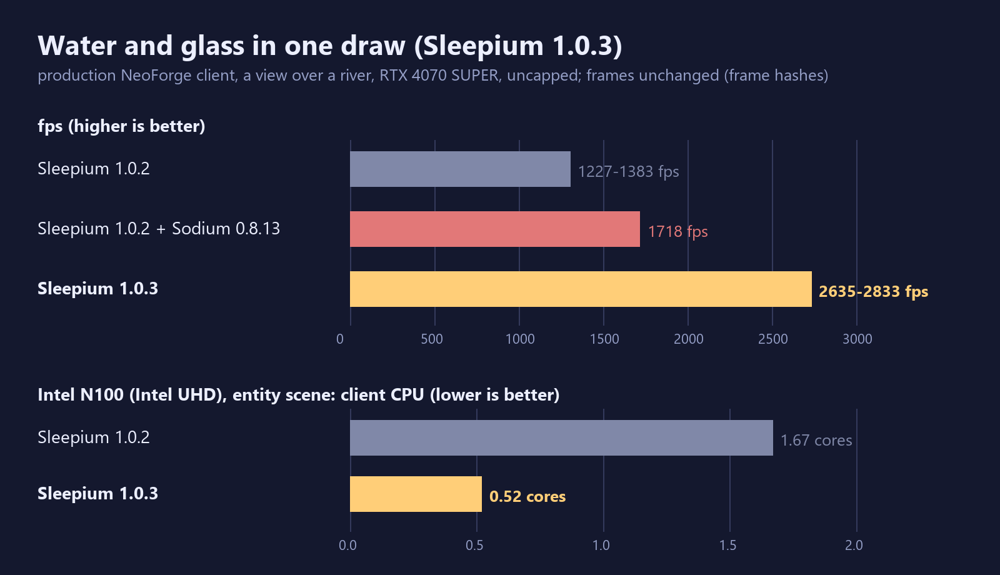

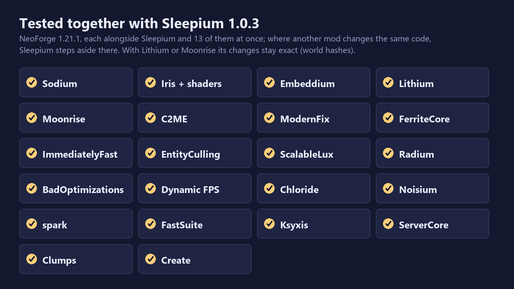

## Results at a glance

Intel N100 (4 cores, 6 W, Intel UHD Graphics, 16 GB): server milliseconds per tick (MSPT) as reported by vanilla's
`/tick query`, lower is better. "vanilla" is the same jar with every optimisation off (`-Dlab.opt.defaults=false`).

| scene | what it stresses | vanilla | Sleepium | |
|---|---|---:|---:|---:|
| items | 4 000 item stacks that cannot merge | 109.60 | 8.00 | ×13.7 |
| hoppers | 1 024 idle hoppers | 2.78 | 0.73 | ×3.8 |
| carts | items among sliding minecarts on ice | 36.97 | 10.82 | ×3.4 |
| furnaces | 1 024 furnaces | 1.25 | 0.55 | ×2.3 |
| fluids | water and lava flowing on a grid | 10.43 | 5.15 | ×2.0 |
| cramming | 200 cows in one 1×1 column | 13.22 | 6.75 | ×2.0 |
| pistons | 200 observer clocks with sticky pistons | 8.00 | 4.20 | ×1.9 |
| mobs | 300 farm animals + 50 villagers | 18.48 | 10.00 | ×1.8 |
| villagers | 120 villagers, 64 workstations | 16.57 | 10.57 | ×1.6 |
| smelters | 1 024 chest→hopper→furnace→hopper→chest columns | 3.77 | 2.38 | ×1.6 |
| crops | 64×64 farmland, random ticks | 0.75 | 0.53 | ×1.4 |
| redstone | 32 observer clocks → dust → lamps | 12.12 | 9.78 | ×1.2 |

All numbers are from one evening (the release jar on 2026-11-01, vanilla from the same session). Client on the same
machine: an entity / block-entity scene **39 → 117 fps** (frame p50 25.6 → 7.7 ms, garbage
3 952 → 113 KiB per frame). On a desktop (Ryzen 7 5800X, RTX 4070 SUPER): the same scene **67 → 1 514–1 540 fps**,
300 animated mobs 175 → 1 782 fps, items on the server 48.9 → 3.1 ms per tick. Against Horizon, a Rust rewrite of Minecraft, the client draws 13–32 %
more frames on the N100, and the server is ahead on items, hoppers, furnaces and pistons
([Against other projects](#against-other-projects)). All tables are below.

The world after N ticks is the same as vanilla's in every scene where vanilla itself is reproducible (see
[Exactness](testing.md#exactness)).

## Results

### Items and experience orbs (1.1.8, 2026-11-08)

Two scenes from players' reports (a Cursed Fate fight, 2 000 cows killed): **drops** - 1 128 dropped items of 8 kinds
and 1 081 experience orbs lying one block apart; **crowd** - 2 000 orbs and 1 500 items around a survival player who
lands in the middle and picks them up (the orbs fly to the player, merge and are collected). Host: Ryzen + RTX 4070
SUPER; N100: Intel N100, 4 cores, integrated graphics. Production clients (the release jar) unless noted; "vanilla" is
the same game with Sleepium's optimisations off.

| scene, client | vanilla | 1.1.7 | 1.1.8 | 1.1.8 + Clumps | vanilla + Clumps |
|---|---:|---:|---:|---:|---:|
| crowd, host, fps | 1 | 194 | 215-219 | 996 | 128 |
| crowd, N100, fps (two runs each) | 1 / 1 | 24 / 22 | 24 / 27 | 89 | 29 |
| crowd, N100, worst frames (p99), ms | 4 114 / 3 093 | 418 / 287 | 389 / 211 | 61 | 549 |
| crowd, N100, client tick, ms | 155 / 149 | 18.0 / 18.9 | 16.0 / 15.3 | 8.0 | 19.8 |
| drops, host, fps (1.21.1) | 182 | 1 066 | 2 094 | | |
| drops, host, fps (1.20.1, dev client) | 128 | 980 | 1 621 | | |
| drops, N100, fps / client tick, ms (two runs each) | | 130-132 / 12.6-11.8 | 136 / 9.5 | | |

On the N100 the crowd runs on one pre-generated world copied for every run: a fresh world kept generating chunks during
the measurement (45 % of the CPU) and made the numbers noise. The N100's fps in the drops scene is bound by its
graphics; what 1.1.8 removes there is CPU time (the client tick) and stutter. Clumps merges experience orbs, which
changes how they behave in the game; Sleepium never does, it only makes the same game cheaper.

Server, ms per tick, the same ticks in both (production NeoForge; the host with deterministic stepping, the N100 with
vanilla's /tick query):

| scene | host: 1.1.7 | host: 1.1.8 | N100: 1.1.7 | N100: 1.1.8 |
|---|---:|---:|---:|---:|
| 900 experience orbs over 30 kinds of floor | 5.39 | 4.70 | 20.85 | 18.23 |
| 4 000 items | 7.78 | 7.25 | 24.98 | 22.10 |
| mobs | 7.15 | 6.50 | 28.63 | 25.55 |
| villagers | | | 28.90 | 24.92 |

### Server, N100 (2026-11-01)

`h2h.py` on a NeoForge 1.21.1 server with the built jar: a fresh flat world per server, 40 s warm-up per scene, then
four 100-tick windows of `/tick query` (20 s); `-Xmx2G`. Values are ms per tick (mean of the windows).

The [table above](#results-at-a-glance) gives vanilla against this release. To check for regressions, the release
was also measured against the engine's last build before it became a standalone mod. Scene groups alternated between
the two jars:

| scene | previous build | this release | memory (RSS), previous → release |
|---|---:|---:|---|
| items | 8.55 | 8.00 | 885 → 755 MB |
| mobs | 10.25 | 10.00 | 919 → 814 MB |
| villagers | 10.10 | 10.57 | 922 → 816 MB |
| hoppers | 0.73 | 0.73 | |
| smelters | 2.67 | 2.38 | |
| furnaces | 0.80 | 0.55 | |
| cramming | 6.85 | 6.75 | |
| redstone | 9.75 | 9.78 | |
| pistons | 4.57 | 4.20 | |
| crops | 0.50 | 0.53 | |
| fluids | 5.20 | 5.15 | |
| carts | 10.90 | 10.82 | |

In every earlier pass of the night villagers came out 3–5 % slower than the previous build, always with the release
run first. Three more pairs with the order reversed came back level: previous build 10.20 / 9.85 / 9.75 (mean 9.93),
release 10.62 / 9.65 / 9.65 (mean 9.97), p50 9.1–9.7 in both. The release uses about 100 MB less memory, because the
animation framework built on the engine is no longer in the same jar.

### Server, N100, other JVM flags (2026-11-01)

Does the result depend on how the JVM is started? The same comparison was run twice more, with scene groups
alternating which side goes first:

- with the whole heap committed and touched up front: `-Xms2G -Xmx2G -XX:+AlwaysPreTouch`;
- with the G1 settings most server hosts use ("Aikar's flags": `-Xms2G -Xmx2G -XX:+AlwaysPreTouch -XX:+UseG1GC
  -XX:+ParallelRefProcEnabled -XX:MaxGCPauseMillis=200 -XX:+UnlockExperimentalVMOptions -XX:+DisableExplicitGC
  -XX:G1NewSizePercent=30 -XX:G1MaxNewSizePercent=40 -XX:G1HeapRegionSize=8M -XX:G1ReservePercent=20
  -XX:G1HeapWastePercent=5 -XX:G1MixedGCCountTarget=4 -XX:InitiatingHeapOccupancyPercent=15
  -XX:G1MixedGCLiveThresholdPercent=90 -XX:G1RSetUpdatingPauseTimePercent=5 -XX:SurvivorRatio=32
  -XX:+PerfDisableSharedMem -XX:MaxTenuringThreshold=1`).

| scene | pre-touched: vanilla | Sleepium | | Aikar's flags: vanilla | Sleepium | |
|---|---:|---:|---:|---:|---:|---:|
| items | 143.93 | 8.97 | ×16.0 | 115.12 | 8.95 | ×12.9 |
| hoppers | 3.20 | 0.77 | ×4.2 | 3.00 | 0.70 | ×4.3 |
| carts | 35.67 | 10.33 | ×3.5 | 36.53 | 10.90 | ×3.4 |
| furnaces | 1.77 | 0.70 | ×2.5 | 1.55 | 0.90 | ×1.7 |
| fluids | 9.70 | 5.18 | ×1.9 | 10.27 | 5.38 | ×1.9 |
| cramming | 13.43 | 6.58 | ×2.0 | 13.23 | 6.53 | ×2.0 |
| pistons | 7.47 | 4.30 | ×1.7 | 7.70 | 4.45 | ×1.7 |
| mobs | 18.80 | 10.38 | ×1.8 | 19.18 | 10.05 | ×1.9 |
| villagers | 18.20 | 10.32 | ×1.8 | 17.08 | 10.40 | ×1.6 |
| smelters | 4.40 | 2.93 | ×1.5 | 3.77 | 2.67 | ×1.4 |
| crops | 0.90 | 0.55 | ×1.6 | 0.80 | 0.53 | ×1.5 |
| redstone | 12.02 | 10.00 | ×1.2 | 12.30 | 9.93 | ×1.2 |

The gains hold under both. With the defaults (`-Xmx2G` alone) G1 starts with a small heap and young generation, so a
fresh JVM reuses its touched pages early; the first-touch effect seen on the host with a fixed 4 GB heap does not
apply there.

### Server, host (2026-11-01)

`tools/bench.py`, heap 4 GB pre-touched, 30 s warm-up, then 30 s of `/tick query` windows per scene. Values are ms per
tick, lower is better.

| scene | vanilla (mean / p50 / p99) | Sleepium (mean / p50 / p99) | |
|---|---:|---:|---:|
| items | 48.93 / 49.00 / 59.10 | 3.08 / 3.00 / 5.50 | ×15.9 |
| carts | 11.35 / 11.30 / 28.50 | 3.12 / 2.90 / 7.00 | ×3.6 |
| hoppers | 0.40 / 0.40 / 0.70 | 0.20 / 0.20 / 0.50 | ×2.0 |
| furnaces | 0.40 / 0.40 / 0.70 | 0.20 / 0.20 / 0.50 | ×2.0 |
| mobs | 4.43 / 4.50 / 16.20 | 2.48 / 2.50 / 11.50 | ×1.8 |
| fluids | 3.00 / 0.80 / 27.20 | 1.75 / 0.50 / 15.80 | ×1.7 |
| cramming | 3.52 / 3.50 / 5.60 | 2.10 / 2.10 / 2.70 | ×1.7 |
| pistons | 4.45 / 4.30 / 12.60 | 2.70 / 2.60 / 9.70 | ×1.6 |
| crops | 0.65 / 0.60 / 2.80 | 0.40 / 0.40 / 1.00 | ×1.6 |
| villagers | 4.72 / 4.40 / 28.40 | 3.38 / 3.10 / 24.40 | ×1.4 |
| smelters | 0.95 / 0.60 / 20.30 | 0.82 / 0.50 / 23.20 | ×1.2 |
| redstone | 3.80 / 0.30 / 26.50 | 3.48 / 0.30 / 16.20 | ×1.1 |

`/tick query` reports in steps of 0.1 ms. Smaller scenes were also repeated in earlier passes the same night. On those
passes, scenes that came out close (furnaces, crops) were re-run twice, interleaved, and the engine was level or
ahead every time (furnaces 0.52–0.55 → 0.30, crops 0.20 → 0.20). The host is a desktop with other load, so single
p99 spikes are not a pattern.

### Client, N100 (2026-11-01)

Self-driving client (`-Dsleep.clientAuto`): fixed seed, vsync off, unlimited fps. The client waits 150 s for the
world to load, builds the scene, then measures 30 s at a fixed position. Window 1280×720.

| scene | | vanilla | previous build | Sleepium |
|---|---|---:|---:|---:|
| entities: 120 armour stands, 235 item frames, 69 chests, 69 signs, 46 skulls | fps | 39 | 118 / 115 | 117 |
| | frame p50 / p99, ms | 25.6 / 38.1 | 7.8 / 14.8 | 7.7 / 18.3 |
| | garbage per frame | 3 952 KiB | 115–149 KiB | 113 KiB |
| mobs: 300 animated mobs | fps | 76 | 138 | 138 |
| | frame p50 / p99, ms | 11.7 / 21.8 | 6.6 / 16.0 | 5.9 / 17.3 |
| | garbage per frame | 832 KiB | 83 KiB | 82 KiB |
| light: 196 light sources switched every 2 ticks | fps | 144 | 157–161 | 158–160 (release: 159) |
| | frame p50 / p99, ms | 5.8 / 18.1 | 5.9–6.2 / 12.1–13.8 | 5.9–6.1 / 12.1–16.0 |

"Previous build" is the engine's last build before it became a standalone mod. The "Sleepium" column is the release
jar; ranges come from repeated runs of the same build. Frame rates are level.

One open point is CPU use in the light scene. The previous build used 0.60–0.78 cores (mean 0.69, 5 runs) and this
engine 0.70–0.88 (mean 0.78, 8 runs). In the two pairs run back to back with identical flags the two were level
(0.77 / 0.71 against 0.72 / 0.78). The extra time is in the shared worker pool, which does light and section
meshing. Vanilla uses 0.44 cores here: the engine runs that work on workers in parallel with the frame.

### Client, host (2026-11-01)

`tools/client_bench.py`: the same self-driving client from `./gradlew runClient` of this build, window 1280×720,
vsync off, unlimited fps, heap 3 GB pre-touched, 40 s for the terrain, 30 s measured. NVIDIA RTX 4070 SUPER.

| scene | | vanilla | Sleepium | |
|---|---|---:|---:|---:|
| entities | fps | 67 | 1 514 / 1 540 | ×23 |
| | frame p50 / p99, ms | 14.7 / 18.3 | 0.58 / 1.54 | |
| | garbage per frame | 3 953 KiB | 68–88 KiB | |
| mobs | fps | 175 | 1 782 | ×10 |
| | frame p50 / p99, ms | 5.5 / 7.8 | 0.50 / 2.76 | |
| | garbage per frame | 841 KiB | 38 KiB | |
| light | fps | 511 | 2 813 | ×5.5 |
| | frame p50 / p99, ms | 1.8 / 8.5 | 0.33 / 0.80 | |
| | garbage per frame | 187 KiB | 24 KiB | |

Without a frame cap the engine uses more cores (mobs 1.9 → 3.8) because it draws ten times as many frames. Per frame
it costs a fraction of vanilla's CPU.

Measured earlier on the host, uncapped (RTX 4070 SUPER), vanilla → Sleepium: terrain 242–283 → ≈1 840 fps; 225 mobs
167 → ≈1 775 fps; the entity / block-entity scene 64 → ≈690 fps (later 994). At a fixed 60 fps the whole client process
used 0.74 → 0.28 cores.

### World generation

On the host, 43–56 chunks/s in vanilla → 158–160 chunks/s (a second batch, everything warm). Single-threaded work per
chunk drops from 71.9 ms and 19.1 MB of garbage to 35.5 ms. On the N100, 12 → 25.6 chunks/s once warm.

### Against other projects

- **Sodium 0.8.13** (host, same day, render distance 12). Terrain is on par: Sodium 1 697–1 827 fps against
  1 762–1 912. The entity scene is about 10× faster: Sodium 146 fps against 1 500–1 680. On terrain, Sleepium's process
  used ~0.9 core more, all of it in the NVIDIA driver's own thread; that is not explained yet. With a shaderpack
  (Complementary Reimagined r5.9.3, 2026-11-02): 538 entities with shadows, Iris + Sodium 68–73 fps against Sleepium's
  484; the terrain view, Iris + Sodium 477–515 against 452–475 (GPU-bound there; see the shaderpacks section).

  
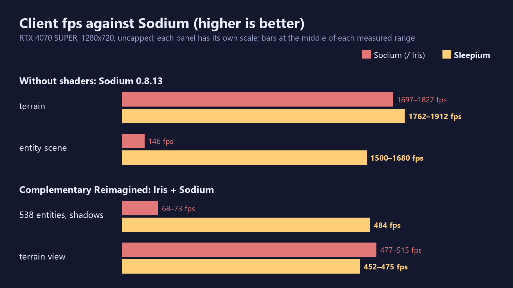

- **Horizon** (a Rust rewrite of Minecraft 26.3, release 0.2.97), on the N100 on 2026-10-30. The versions differ, so
  each is shown next to its own vanilla. Values are ms per tick, two interleaved passes.

  | scene | vanilla 1.21.1 | Sleepium | vanilla 26.3 | Horizon |
  |---|---|---|---|---|
  | items | 127 / 130 | **8.5 / 8.5** | 97 / 83 | 14.7 / 13.7 |
  | hoppers | 3.2 / 2.5 | **0.73 / 0.70** | 1.2 / 1.4 | 2.7 / 2.7 |
  | smelters | 3.7 / 3.9 | 2.9 / 2.4 | **2.3 / 2.7** | 11.4 / 11.5 |
  | furnaces | 1.4 / 1.4 | **0.78 / 0.75** | 0.85 / 1.5 | 0.97 / 1.0 |
  | pistons | 7.4 / 7.3 | **4.1 / 4.5** | 6.1 / 6.0 | 6.2 / 6.1 |
  | mobs | 18.9 / 17.9 | 10.1 / 10.0 | 15.0 / 14.3 | **8.2 / 8.1** |
  | villagers | 17.8 / 17.0 | 12.2 / 12.0 | 12.7 / 12.7 | **5.6 / 5.1** |
  | cramming | 14.0 / 12.9 | 6.5 / 6.5 | 9.3 / 9.8 | **4.7 / 4.7** |
  | redstone | 12.2 / 12.0 | 10.1 / 10.0 | 10.8 / 10.7 | **8.4 / 8.4** |
  | carts | 37.6 / 33.0 | 10.9 / 11.0 | 31.0 / 31.0 | **8.1 / 8.0** |
  | fluids | 9.9 / 10.2 | 5.0 / 5.0 | 6.1 / 6.2 | **0.47 / 0.47** |
  | crops | 0.8 / 0.8 | 0.5 / 0.5 | 0.6 / 0.6 | 0.5 / 0.5 |
  | memory (RSS) | 0.7–0.9 GB | 0.7–0.9 GB | 0.6–0.8 GB | **0.37–0.45 GB** |

  **Client: Sleepium draws more frames than Horizon in every scene**, on the same N100, the same view and 1280×720 (the
  same session, 2026-10-30):

  | client scene | vanilla 1.21.1 | Sleepium | Horizon | Sleepium against Horizon |
  |---|---:|---:|---:|---:|
  | entities | 37 fps | **115 fps** | 87 fps | +32 % |
  | mobs | 70 fps | **136 fps** | 112 fps | +21 % |
  | light | 132 fps | **156 fps** | 138 fps | +13 % |

  Horizon draws with Vulkan (wgpu) and keeps frame-time p99 lower (10–14 ms against 17–33 ms); Sleepium has the lower
  p50. Horizon is ahead on mobs and
  villagers partly because of its data layout and partly because some of its shortcuts are not vanilla-exact. Sleepium
  keeps the vanilla game and its mods.

  
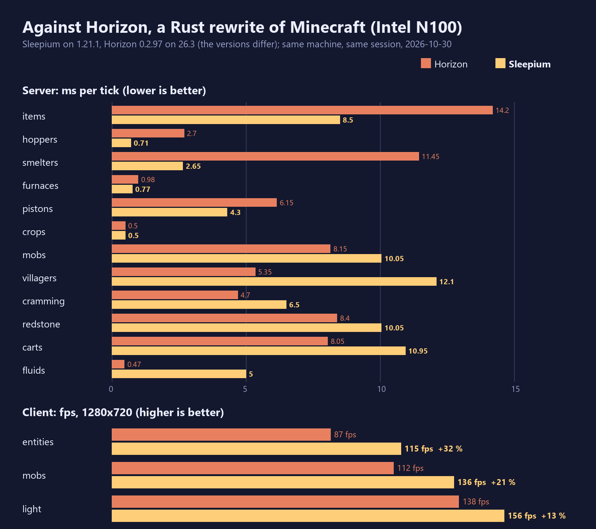

- **Lithium 0.15.4 and Moonrise 0.1.0-beta.15** (N100, 2026-11-01): a production NeoForge server, each mod alone in
  the mods folder, the scene groups in rotating order; mean ms per tick (1–3 passes per scene, the 11-01 build).

  | scene | vanilla | Lithium | Moonrise | Sleepium |
  |---|---:|---:|---:|---:|
  | items | 115.05 | 17.00 | 10.53 | **8.48** |
  | hoppers | 2.57 | 0.80 | 2.67 | **0.70** |
  | cramming | 13.28 | 10.57 | 9.10 | **6.47** |
  | mobs | 19.07 | 13.65 | 14.88 | **10.12** |
  | villagers | 15.82 | 11.43 | 18.38 | **10.25** |
  | smelters | 3.73 | 4.08 | 3.45 | **2.52** |
  | furnaces | 1.63 | 1.15 | **0.77** | **0.77** |
  | carts | 37.28 | 12.17 | **8.96** | 10.35 |
  | pistons | 7.89 | 6.95 | **3.99** | 4.22 |
  | crops | 0.67 | 0.71 | **0.30** | 0.47 |
  | fluids | 10.33 | **4.88** | 6.00 | 5.43 |
  | redstone | 12.03 | **8.10** | 8.65 | 9.94 |

  Sleepium is ahead in six scenes and level in one; Moonrise leads on carts, pistons and crops (its chunk system and
  collisions), Lithium on fluids and redstone. Together with them: see [Compatibility](compatibility.md).

  
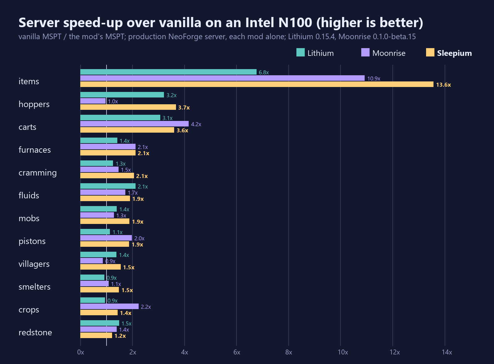

- **C2ME, ModernFix, FerriteCore**: no A/B has been run yet.

## On 1.20.1 / Forge

Intel N100, production Forge 1.20.1 server with the built jar, ms per tick (`/tick query`):

| scene | vanilla | Sleepium |
|---|---:|---:|
| items | 114.9 | 10.7 |
| hoppers | 6.68 | 2.4 |
| mobs | 22.2 | 13.25 |
| villagers | 19.3 | 14.0 |

1.20.1 keeps 23 x 23 spawn chunks loaded and walks them every tick (1.20.5+ has the spawnChunkRadius rule, 2 by
default): most of what is left between the versions on light servers is vanilla's own.

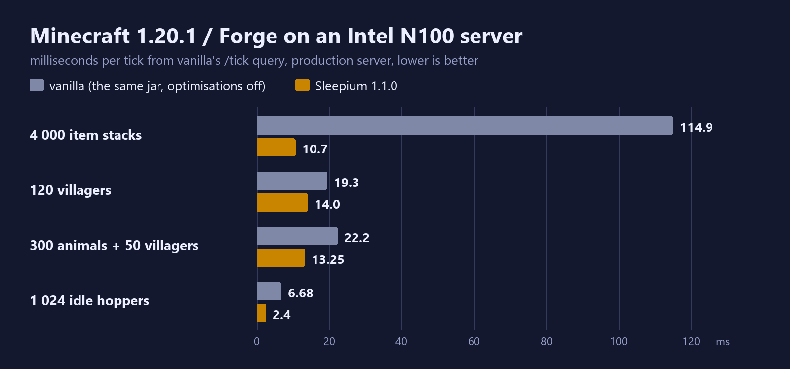

Client, the fights from a player's Cursed Fate videos (840 entities, zombies burning at noon, the set's effects; RTX
4070 SUPER): vanilla 87 fps, Sleepium 600-646; with Oculus + Embeddium installed 289 -> 299 (next to Oculus the
entities stay on the render thread).

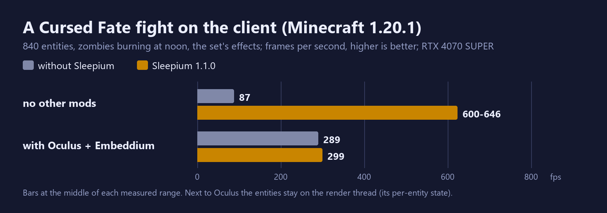

Desktop server tables next to Radium, Canary and ModernFix: [Compatibility](compatibility.md#minecraft-1201--forge).
